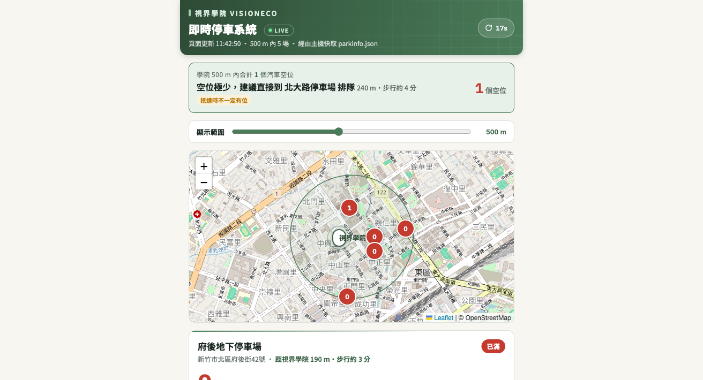

# 視界停車 Vision Parking

**「老闆，你們那邊好停車嗎？」——這個系統就是那句話的答案。**

一個可以放進任何官網、LINE、Google 商家檔案的即時停車頁：以你的店（或教室、住家、公司）為圓心，即時顯示周邊停車場還剩幾個位子、建議停哪裡、走過來幾分鐘。客人出發前看一眼，到了直接停——不用繞、不會遲到、不會「算了改天再去」。

**Live Demo（以新竹的視界學院為中心）：https://parking.visioneco.tw/**

> A real-time parking availability dashboard for any location in Hsinchu City, Taiwan — single-file static page + tiny VPS cron pipeline. Zero framework, zero build step, near-zero running cost. Fork it, change one coordinate, and it becomes *your* store's parking page.



## 為什麼做這個

「找不到車位」是實體場域最隱形的流失原因：客人在附近繞了十分鐘，下次就直接去好停車的那家了。我們是教育機構，學員遲到最常見的原因不是塞車，是**到了之後在繞停車位**。與其在報名信裡貼三個停車場地址，不如給一個「出發前看一眼就知道怎麼停」的頁面——做完之後發現，這對任何開實體店的人都有用，所以開源。

## 誰適合用

- 🏪 **實體店家**：餐廳、診所、美髮、健身房、工作室——把連結放官網和訂位確認訊息裡，「好停車」本身就是服務的一部分
- 🏫 **教室與活動場地**：課前、活動前把連結發到群組，遲到率有感下降
- 🏠 **住家**：以家為圓心，回家前看一眼今晚該停哪
- 🏢 **通勤族**：以公司為圓心，上班前少繞兩圈

改一組座標就是你的版本，手機加入主畫面後就像一個專屬 App。

## 功能

- 🅿️ **即時空位**：介接新竹市政府「好停車」開放資料，頁面每 20 秒自動更新
- 📍 **距離篩選**：以中心點畫圓（100 m〜1 km 滑桿可調），依「有位優先＋距離最近」動態排序
- 🧭 **智慧建議**：自動推薦去哪停；空位少提醒排隊、全滿建議一鍵擴大範圍；只剩電動／身障位會註明
- 🗺 **地圖**：Leaflet + OpenStreetMap，每場即時空位數直接標在地圖上
- 🌦 **目的地即時天氣**：介接 [Open-Meteo](https://open-meteo.com/)（免金鑰），顯示目的地現在溫度、3 小時內降雨機率、紫外線，並給一句白話建議（帶傘／防曬／帶外套）——從外地來的人出門前一眼搞定
- 📈 **訪客長期統計**：`log-visitors.py` 每小時把 nginx 紀錄萃取成每日彙總存進 SQLite（nginx 只保留 14 天，這裡永久保存）；只存**加鹽雜湊後的 IP**，不留原始 IP，可算出不重複訪客與回訪率；用 `visitor-report.py` 看報表
- 🛟 **斷線備援**：市府資料停更超過 15 分鐘，那張卡片會標註「這個數字是 N 分前的」，並改給同時段的歷史預測，使用者仍有答案可參考
- 📊 **歷史統計**：每 2 分鐘快照進 SQLite，彙整「近 28 天平日／週末 × 24 小時平均剩餘」，卡片顯示「這時段通常剩約 N 位」——客人連「幾點來比較好停」都能提前知道
- 📱 **手機優先**：可加入主畫面（PWA manifest＋品牌圖示）、深色模式、`prefers-reduced-motion` 支援

## 架構

```
瀏覽器 ──每20秒──▶ nginx 靜態頁 + JSON 快取（同一台 VPS）
                        ▲
        cron 每20秒 ────┤ fetch-parkinfo.sh   ◀── 新竹市好停車 OpenData
        cron 每10分 ────┤ fetch-weather.py    ◀── Open-Meteo 天氣
        cron 每2分 ─────┤ log-parkstats.py    ──▶ SQLite → stats.json（歷史預測）
        cron 每小時 ────┘ log-visitors.py     ──▶ SQLite（匿名使用統計）
```

設計原則：**頁面不直連任何第三方 API**。伺服器把外部資料抓成靜態 JSON，瀏覽器只讀自己主機的快取——速度快、不怕 CORS、不怕把上游打掛，API 金鑰也永遠不會出現在前端。一台每月 6 美元的最小 VPS 綽綽有餘。

## 快速部署

需求：一台 Ubuntu/Debian VPS（1GB RAM 足夠）＋（選用）網域。

```bash
# 1. 把整個資料夾放上 VPS，執行：
sudo bash deploy-vps.sh
# 會自動：裝 nginx、放置頁面、設 cron、開防火牆 80 port

# 2.（選用）HTTPS：DNS A 紀錄指到 VPS 後
sudo apt install certbot python3-certbot-nginx
sudo certbot --nginx -d 你的網域
```

## 改成你的店／你的城市

**同在新竹市**：只要改 `hsinchu-parking.html` 裡的中心座標，五分鐘完工——

```js
const CENTER = { lat: 24.80725, lng: 120.96794 };  // 換成你的店的座標
const RADIUS_MIN = 100, RADIUS_MAX = 1000, RADIUS_DEF = 500;  // 範圍滑桿
```

**其他城市**：把資料來源 `API` 換成你所在縣市的停車開放資料（各縣市格式不同，`render()` 內的欄位對應需一併調整）。歡迎把你的城市版本 fork 出去，也歡迎開 PR 回來讓這裡支援更多城市。

**路邊停車（智慧停車柱）**：部分縣市（例如台北市）已把路邊停車格的即時剩餘上架 TDX 的 OnStreet API，同樣的管線模式就能介接，把路邊格位也疊上地圖；新竹市目前尚未上架，哪天開放了本專案會第一時間跟上。

## 市府資料斷線時

實測（2026-09-19 起）新竹市府系統**每週六傍晚 4 點 40 分左右會例行暫停 20–40 分鐘**，其他時間可用率接近 100%。暫停期間：

- 卡片標註「這個數字是 N 分前的」，並改顯示同時段的歷史預測（週六傍晚還會說明通常多久恢復）
- `sudo check-health.py` 會列出近 4 週的中斷紀錄，方便確認規律有沒有改變

> 早期版本有 YouBike 圖層（介接交通部 TDX），因實際使用率接近零，2026-10-16 移除以保持介面簡潔。

## 使用統計與隱私

- 網頁只把「開啟、點導航、點 LINE 回饋、點擴大範圍」這類匿名事件送回**自己的主機**（`/e`，nginx 回 204 只留紀錄），不使用任何第三方追蹤
- `log-visitors.py` 每小時把 nginx 紀錄彙總進 SQLite；IP 只存加鹽雜湊，用來算回訪率；原始紀錄依 logrotate 14 天後刪除
- `sudo visitor-report.py [天數]` 看報表：每日訪客、開啟、導航點擊、最常被導航的停車場、回訪率

## 資料來源與致謝

- 停車場即時資訊：[新竹市政府交通處「好停車」開放資料](https://hispark.hccg.gov.tw/)（[政府資料開放平臺 #129136](https://data.gov.tw/dataset/129136)）
- 天氣資訊：[Open-Meteo](https://open-meteo.com/)（CC BY 4.0）
- 地圖圖資：© [OpenStreetMap](https://www.openstreetmap.org/copyright) 貢獻者

本專案與新竹市政府、交通部無任何隸屬關係；資料僅供參考，實際車位以現場為準。

## License

[MIT](LICENSE) — 拿去用、改成你的店、部署到你的城市，都不用問。做出你的版本歡迎回來留個 issue 分享，對你有幫助的話，給顆 ⭐ 就是最好的回饋！
